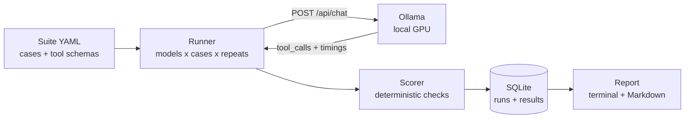

# toolcall-bench

[](https://github.com/korearn/toolcall-bench/actions/workflows/ci.yml)

Deterministic tool-calling evals for local LLMs that fit in 16 GB of VRAM.

> **Status:** pre-alpha. The scaffold is in place; the first benchmark lands with `v0.1.0`.

## Problem

Public leaderboards do not tell me which quantized model I can trust to call tools on *my* GPU.
Picking by feel means agents that fail silently: wrong tool, malformed arguments, or a tool call
when none was needed. `toolcall-bench` runs the same suite of tool-calling cases against every
local model and reports pass rate, consistency, speed and VRAM side by side.

## Architecture



## Quickstart

Requires [uv](https://docs.astral.sh/uv/) and, from `v0.1.0` on, a running [Ollama](https://ollama.com) server.

```bash
git clone https://github.com/korearn/toolcall-bench.git
cd toolcall-bench
uv sync
uv run tcb --version
```

## Demo

_TODO (milestone 8): GIF of `tcb run` + `tcb report`._

## Results

_TODO (milestone 7): leaderboard on Ryzen 7 5800X / RTX 4070 Ti Super 16 GB / 32 GB RAM._

## Decisions and trade-offs

_TODO: one entry per decision, added as milestones close._

## Development

```bash
uv run ruff check .
uv run ruff format --check .
uv run pytest
```

## License

[MIT](LICENSE)
